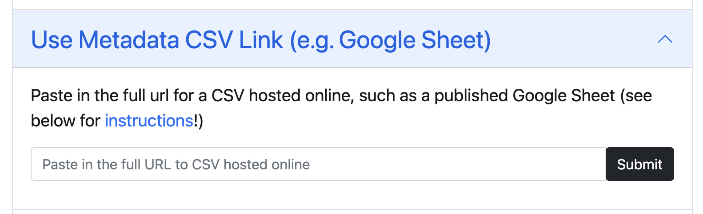

## AE#5: Build your Online Metadata Collection {.smaller}

##### Important Links

> Metadata Guidelines: <https://collectionbuilder.github.io/collectionbuilder-sheets/metadata.html>
>
> Deploy them on [Collection Builder](https://collectionbuilder.github.io/) using the instructions [here](https://collectionbuilder.github.io/cb-docs/docs/walkthroughs/sheets-walkthrough/)

##### Instructions

1.  Make a copy [metadata-template file](https://docs.google.com/spreadsheets/d/1Uv9ytll0hysMOH1j-VL1lZx6PWvc1zf3L35sK_4IuzI/copy?usp=sharing) in your Google Sheets

2.  Choose a topic of your interest and paste atleast 15-20 resources in the file (such as books written by a specific author, or books on a particular topic)

3.  Publish your Google Sheets and Paste the [Link here](https://collectionbuilder.github.io/collectionbuilder-sheets/)

## AE#5 (Cont.) {.smaller}

::::: columns
::: {.column width="50%"}
4.  Visit the [Collection Builder-Sheets default template site](https://collectionbuilder.github.io/collectionbuilder-sheets/)

*Important: To view your objects on the prototype site, the files will need to be available externally on the web (e.g., hosted on your organization’s server or via a platform such as Digital Ocean or Reclaim Hosting). You can also host files for free via GitHub pages.*
:::

::: {.column width="50%"}

:::
:::::

## AE#5 (Cont.) {.smaller}

::::: columns
::: {.column width="50%"}

5.  Click the [*Use Metadata CSV Link*]{.underline} option and paste the shareable link from the Step 3, and then click Submit.

{fig-align="center"}
:::

::: {.column width="50%"}
6.  You should now see a prototype site featuring objects and metadata from your collection. 
:::
:::::

## AE#5 (Cont.) {.smaller}

7.  Share your test site via URL by adding your full metadata link to the end of the CB-Sheets default template like: [*https://collectionbuilder.github.io/collectionbuilder-sheets/?csv=*]{style="color: blue;"}[***your metadata URL here***]{style="color: red;"}

For example:

**https://collectionbuilder.github.io/collectionbuilder-sheets/?csv=**https://docs.google.com/spreadsheets/d/e/2PACX-1vRJhe6UcNZXItEtHlxQFOaHBBD2SDU8nyNOAROtcLWLrl83sYaCNBNYHOvhM_xZ7SVnnOrjCzo6U5_o/pub?o
utput=csv

## Assignment Submission on Canvas {.smaller}

**`POST 1: Group Reflection Post [10 Points]`**

-   Submit one discussion post per group. Include your project title and the names of all group members.

`Reflection Questions [`**`100-150 words]`**

1.  Provide a brief description of the dataset.
    Upload your completed CSV file and include a working URL for your online metadata collection.
    *Links and attachments do not count toward the word limit.*

2.  Create a metadata decision guide table documenting the rules your group followed for names, subjects, dates, descriptions, and missing information.
    Include an example of how you applied each rule.
    Your guide should allow another person to describe an additional resource consistently.
    *No separate paragraph or word count is required.*

## Assignment Submission on Canvas {.smaller}

For example:

| Field Name | Decision Taken |
|------------------------------------|------------------------------------|
| Names | How did you record creators and handle name variations? |
| Subjects | Which vocabulary or local term list did you use, and why? |
| Dates | How did you handle incomplete or uncertain dates? |
| Descriptions | What information did you include for your intended audience? |
| Missing information | What did you leave blank, and why? |

3.  Explain two metadata decisions using concepts from the course. What alternatives did you consider, and why did you choose your approach?

## Assignment Submission on Canvas {.smaller}

4.  Discuss challenges you encountered while creating the metadata records or building the collection prototype. Explain how you addressed them and identify any unresolved limitations.

**`POST 2: Individual Response Post [5 Points; 100–150 words]`**

-   Individually review at least one other group’s collection and discussion post.

-   Identify one strength and offer one specific, constructive suggestion related to metadata consistency, clarity, or resource discovery.

-   Refer to an example from their collection to support your feedback.

-   Each group member should contribute to responding to questions or suggestions received on the group’s post, if any.
